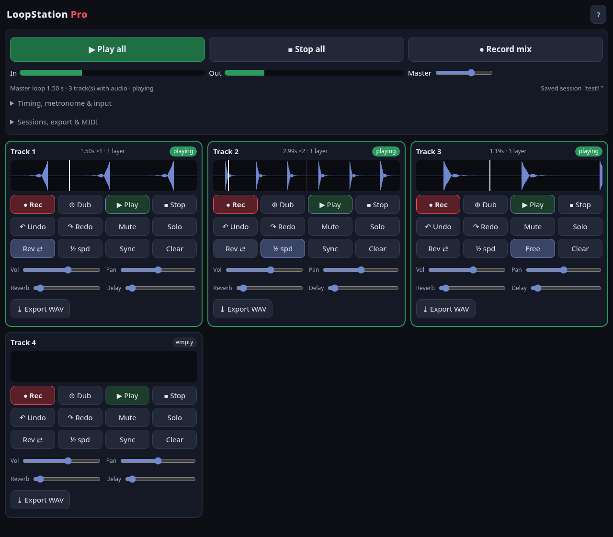
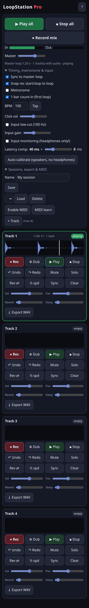

# LoopStation Pro

A live looper that runs in the browser. Record a phrase, loop it, and stack layers on top, in the spirit of live looping performers like Reggie Watts. It installs as an app on desktop and Android and works offline.

**[▶ Try it live](https://mgconn.github.io/loopstation-pro/)**. Use headphones and allow the microphone.

## Features
- **Loops stay in time with each other.** The first loop sets the master length, and later tracks snap to whole multiples of it. Any track can be switched to its own free length.
- **Up to 8 tracks.** Each has record, overdub, undo and redo, mute, solo, reverse and half speed, plus volume, pan, and reverb and delay sends.
- **Clean starts.** Audio is captured raw from the mic, with nothing added at the start of a loop and short fades so the repeat doesn't click.
- **Latency compensation.** It uses the browser's reported delay, plus a click-test calibration and a manual slider.
- **Metronome.** BPM and tap tempo, with a one-bar count-in.
- **Input tools.** Input monitoring, a low-cut filter, and live level meters.
- **Hands-free control.** Keyboard shortcuts (press `?` to see them), and MIDI learn to assign a foot pedal or controller to any button.
- **Saving.** Record a whole performance as a WAV file, export single tracks, and save or reload sessions in the browser.
- **Installable app.** It installs from the browser, works offline, and has a touch-friendly layout for phones.

## Tech
Plain HTML, CSS and JavaScript, using the browser's built-in audio and MIDI support, with no frameworks and no server. Recordings never leave the device.

## Run locally
Open `index.html` in Chrome. To install it as an app and use MIDI, run `./start.sh` (or `start.bat` on Windows) and open http://localhost:8765.

